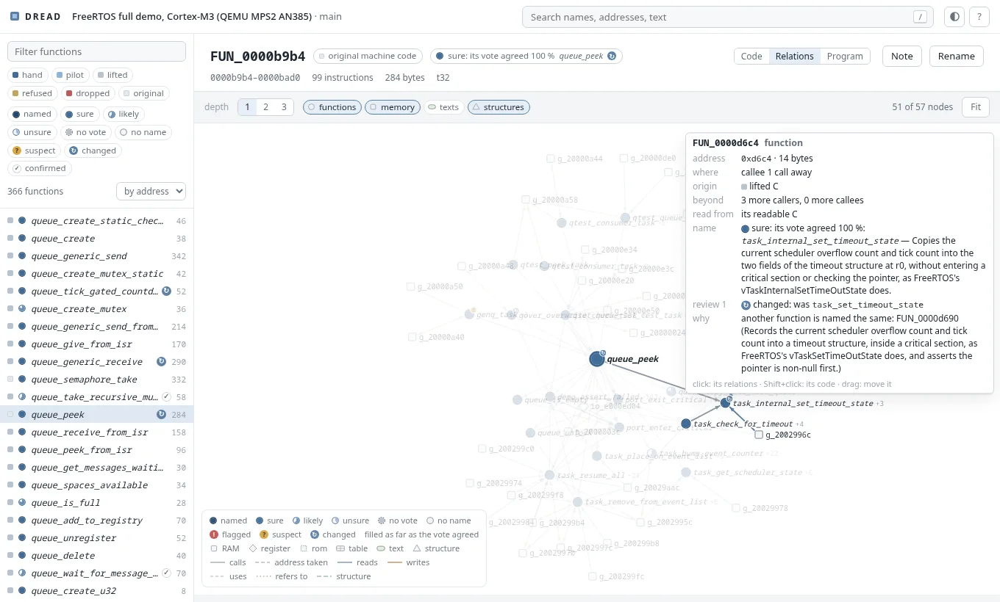
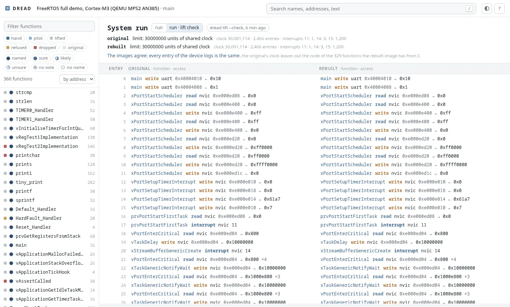
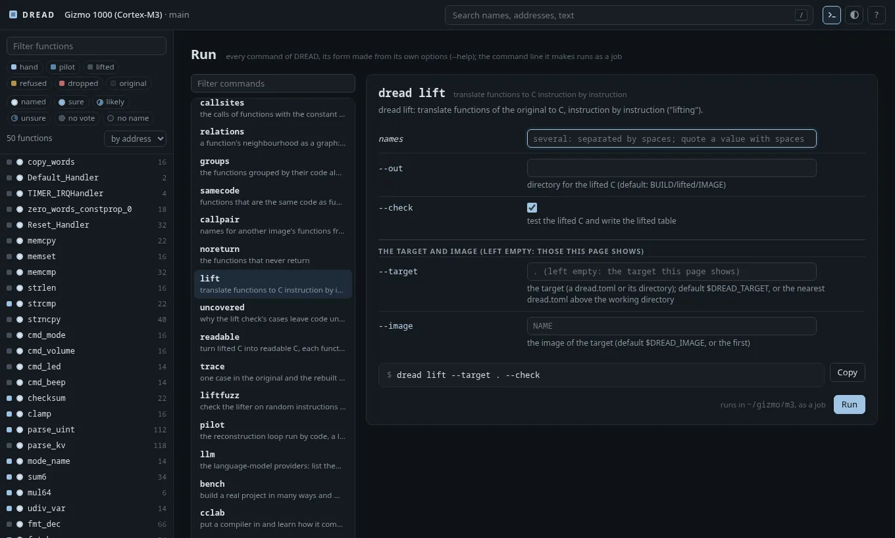
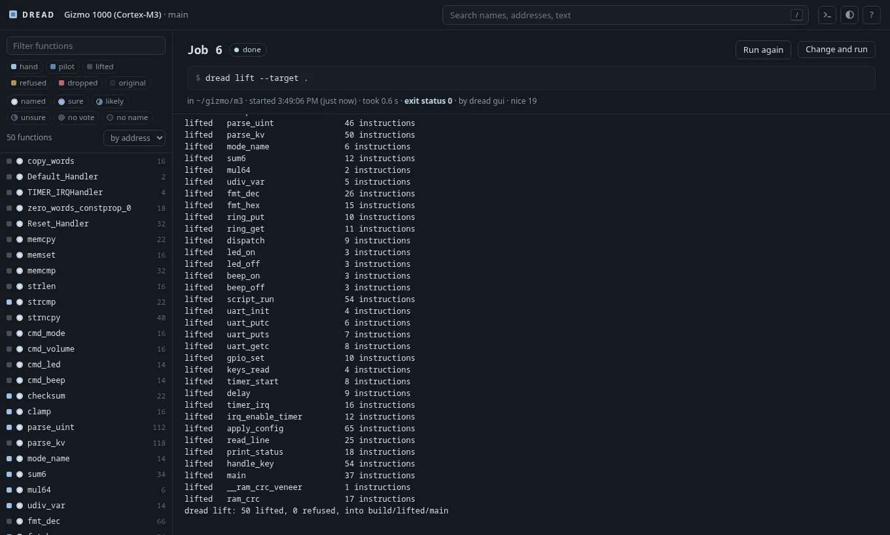
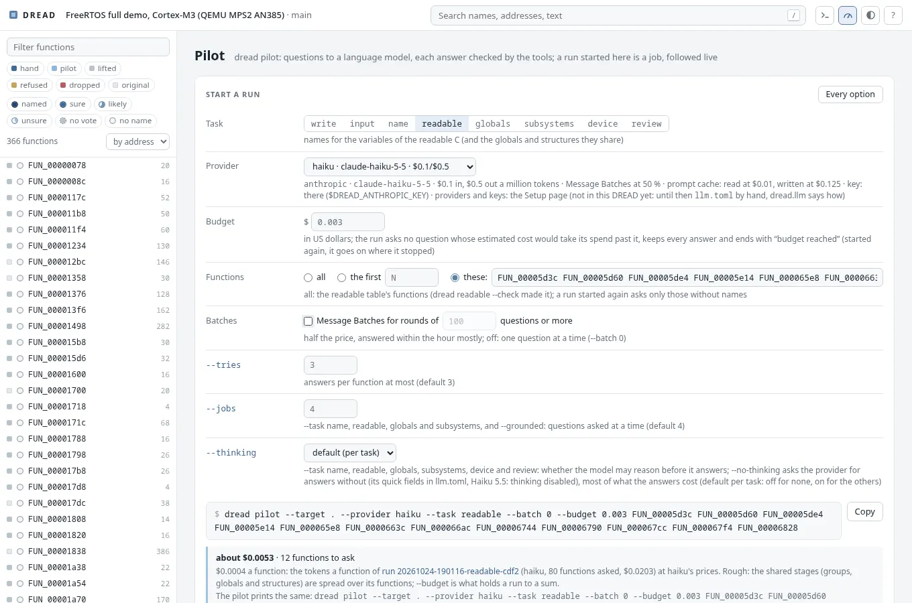
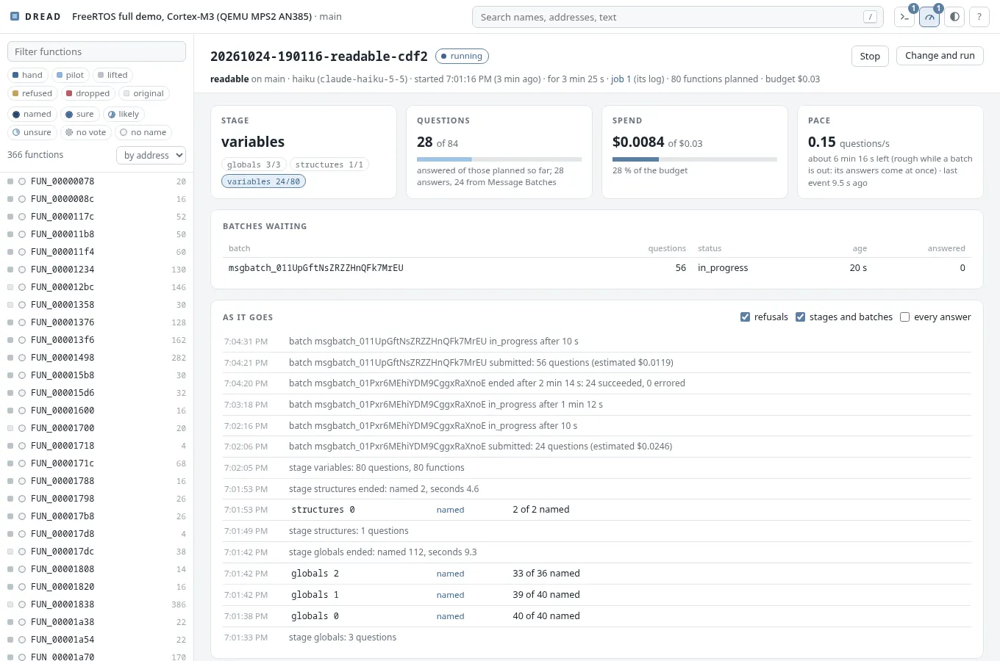

# DREAD

[](https://github.com/dwzg/dread/actions/workflows/test.yml)

**DREAD Reverse-Engineers And Decompiles**: *disassemble, rewrite, emulate and diff.*

A toolkit for rewriting embedded firmware in C, one function at a time, when the original compiler
is not available. Matching-decompilation tools assume you can recompile the original byte for
byte. DREAD instead proves the rewritten function behaves like the original:

1. **Disassemble.** Analysis tables (from Ghidra, or from an ELF when there are symbols) become a
   listing that reassembles to the original image, byte for byte. That rebuild is the baseline
   every change is measured against.
2. **Rewrite.** C functions are linked over the original image at their own addresses: in place
   when they fit, otherwise into space freed by other rewritten functions. Everything not rewritten
   stays the original machine code, so every intermediate state is a complete image. The C comes
   from three sources: written by hand, generated for families of identical functions, or lifted
   mechanically, instruction by instruction, as a first step.
3. **Emulate.** Every rewritten function runs in the original image and in the rebuilt one, in
   Unicorn, with the same inputs. Callees are stubbed and logged, and peripheral accesses are
   recorded in order. Inputs come from hand-written cases and from a generator that is guided by
   coverage and by the values each branch compares. The whole image can also run from reset with
   device models.
4. **Diff.** Return values, memory written, calls made and peripheral accesses must all agree, and
   so must every register a caller reads after the call: a compiler that saw the callee (GCC's
   `-fipa-ra`) may keep a value in a scratch register across it, and a rewrite has to leave that
   register alone. The cases must run every instruction of the original function. A mutation check
   confirms that the cases would notice a wrong function.

What this proves is agreement on the inputs tried, in an emulator. It is not a proof that an image
is safe to run on hardware.

## Status

Early: the tools are being moved over and generalised phase by phase, and the table below says
what works. The method and the first versions of the tools come from the reconstruction of
a 2004 digital camera's firmware (ARM7, ARM state). Here they are being made independent of that
firmware: everything a tool needs to know about a target comes from the target's `dread.toml`.
DREAD tests itself on **gizmo** (`examples/gizmo`), a small firmware written for the purpose and
built five times: with GCC for an ARM7-style core in ARM state, for a Cortex-M3 in Thumb-2 and for a
Cortex-M4 with hard float and the DSP extension (with a signal path of its own on floats); with clang
for an RV32IMC core; and with TI's MSP430 GCC for the 16-bit MSP430.

| Part | State |
|---|---|
| Target description, function tables, ARM and Thumb layer, ELF import | done |
| Listing generator and byte-identical rebuild, Ghidra pipeline | done |
| Emulator, differential test runner, overlay linker | done |
| A failing case traced to the first point where the images part (`dread trace`): calls with their arguments and the bytes behind stack pointers, the device log, stores by stretch, the return; the instruction and C line in both, the call stacks, the frame by the C's objects | first version |
| Case generator (coverage- and compare-guided, pointer learning, a dictionary for parsers, answers for the branches all cases take one way: a callee's result at one call, memory a load reads) | done |
| Why cases leave code unrun (`dread uncovered`): each missed region's way in, what decides it traced back to its source (an argument, a callee's result, a global, a device register, a field, a loop), what the cases saw there and a run sent that way | first version |
| Mutation check with survivor search and argued survivors | done |
| Integration run: generated inputs with real callees, also through original callers | done |
| Register flow across calls: what callers read after a call, compared at the return | done |
| Recorded cases from Python models of callees (`dread record`) | done |
| System run from reset, original against rebuilt, on a shared clock; models for serial port, timer, pins, interrupt controllers (A profile, Cortex-M NVIC with SysTick); each run kept as a record: both device logs with the function behind each entry, and who entered whom (calls through pointers, tasks started by their scheduler, exceptions) | done |
| Lifter for ARM and Thumb-2: instruction by instruction to C, built only when the generated cases agree and run every instruction of the original; its instruction semantics fuzzed against the emulator (`dread liftfuzz`) | done |
| Reading aids: flat listing, call sites with constant arguments, the same code in two images, names by call order, the functions in groups found from their code alone, the subsystems a reader would see (`dread groups`: shared memory, texts and devices, neighbours in memory); renaming everywhere at once (`dread rename`) | done |
| Browser view (`dread gui`): overview and map of the image, listings with coverage, the C, verdicts, search, rename and notes; the system run's device logs of both images side by side; every command from a form made from its own options, run as a job with its log followed; a Setup page: what this machine has, a new target from an ELF or a raw image (a path or an upload), its first analyses as a chain of jobs, the language-model providers with their keys in key files; the pilot started from a short form with an estimate, followed live within its budget, stopped, its runs, costs per month and comparisons; a function's views beside its listing and C: where a failing case parts (`dread trace`), why its cases leave code unrun (`dread uncovered`), the changes to its C no case notices (`dread mutate`), its registers (`dread regflow`, `dread callconv`); the bench's builds with their figures and trends, a compiler's profile from the compiler lab, the leak check's hits, each tool run as a job from its page | done |
| Setting up (`dread doctor`, `dread new`, `dread llm set`/`key`): the prerequisites with what to install for this system's package manager; a target directory and its `dread.toml` from an ELF (architecture, image, startup copies, memory map, compiler and its flags from the debug information, the tables from the symbols) or from a raw image (an architecture of a list, a load address), each guess marked; providers added and changed in `llm.toml` with its comments kept, keys in files of mode 600 | first version |
| Relations (`dread relations`, and in the browser): a function's callers, callees, memory, texts and structures as a graph, each piece marked by how sure its name is (its vote's agreement, and the name review's suspects); the whole program as a graph of its groups (`dread groups --json`), a group opening into its functions, a search lighting the functions and groups it finds; both laid out by a force simulation as they are drawn | first version |
| Claude Code plugin (skills, writer and reviewer agents, a target template) | done |
| Method documentation and a porting guide | done |
| Library functions by their bytes (`dread whatcc`): the C library, libgcc and libm of every toolchain image, the host's and archives of one's own matched against an image's functions, the linker's fields masked: which toolchain's libraries it links (ties said as such) and names for a firmware without symbols (calls checked, ambiguous names given as such); ARM (RISC-V's relaxed calls not yet) | done |
| Readable C from lifted C (`dread readable`): transformations in code on the lifters' C, each function's result built and accepted only as lifted C is (its cases agree and run every instruction, the whole image agrees), else it stays lifted. So far the parser, the gate, the clean-up (flags, dead code, compares as comparisons proved with z3), the structure (if/else and loops for the gotos), calls and parameters as regflow measured them, registers split into their values, names proposed by a language model as a map that code applies and checks (`dread pilot --task readable`, scored against debug information with `dread readable --score`) and carries to the variables the same instructions define when the transformations change the C (`dread readable --carry`, also at the end of `--check`), and the structures behind pointers found by code (`dread readable --shapes`; 91-99 % of the fields it finds are the source's on four FreeRTOS builds) and written into the C as `volatile struct` pointers (`p->f_2c`), static data that one base reaches as one structure's members (`g_20000030.f_4`; from the machine code, a section anchor told apart by what the code does next to it, and from what callees reach through the addresses handed to them: `dread readable --statics`), arrays of static data that the code indexes (`g_200299f8[r3].f_4`, `g_20000c74[1]`) and the addresses of such objects as `&g_20029988`, functions' addresses handed to callees by name (`(u32)&prvTimerCallback`) and texts' in a note beside them (`0xd9cu /* "FR Timer" */`), and the part of a stack frame whose addresses go to callees as one local structure (`stack36.f_4`, `(u32)&stack36.f_4`; accesses that overlap in a union, a buffer only handed on as an array of bytes); measured on the FreeRTOS bench against the sources (`dread bench measure --steps readable`: per build what the gate accepts and why not, gotos, nesting, raw accesses and members left, and each function's statements and nesting against its source function, found through DWARF and read by clang) | in progress |
| Compiler profiles for the lifter and the template families (gcc, older ARM compilers) | next |
| `dread pilot`: the reconstruction loop run by code, an LLM (local or cloud) only for the judgement: writing C, arguing survivors, proposing inputs and names (optionally shown what a function did in runs of its cases: `dread.behaviour`, or the subsystem its group was named from all of the group's evidence: `--subsystems`; scored against the source by a judge that reads it, whatever the names' style: `--score --grounded`; two settings compared over replicate runs, each run judged once and every pairing counted from its verdicts: `--against RUN... --vs RUN...`; existing names taken up again where code finds reasons against them, changed only when a candidate wins a pairwise decision by a margin: `--task review`), naming readable C's variables; every answer checked by the tools. Providers: OpenAI-compatible servers (llama-server, GitHub Models), Anthropic, or a command line that answers (GitHub Copilot CLI, Claude Code headless); `dread llm ask` tries one. What a run costs: a large round of questions goes as one of Anthropic's Message Batches at half the price (`--batch N`), the beginning several questions share (a function's code for its samples, a group's question, the judge's sources) is kept in the provider's prompt cache where `llm.toml` gives the model's minimum (`cache_min`), and `--no-thinking` asks the naming questions without the hidden reasoning that is most of what their answers cost; every answer's tokens and price go into a ledger (`dread pilot --usage`) | first version |
| RISC-V (RV32IMC): gizmo-rv32 built with clang; every tool runs on it: listing with byte-identical rebuild, reading aids, the overlay, differential tests, integration, recorded cases, regflow, switches, Ghidra, the system run with interrupts, the lifter and its fuzzer | done |
| Cortex-M4 (FPv4-SP, DSP extension): gizmo-m4 built with GCC with hard float, run on Unicorn's own Cortex-M4 (the core a target names: an M3 has no FPU); every test runs on it; the lifter, the harness and the system run do not model the FPU and the DSP instructions yet (its float and DSP functions are refused) | under way |
| MSP430: gizmo-msp430 built with TI's MSP430 GCC; a decoder of its own (no capstone), an engine of its own (no Unicorn: a Python interpreter behind Unicorn's interface, checked against GDB's simulator), the listing with byte-identical rebuild, the reading aids, the overlay (into the image's free flash), differential tests with generated cases, the mutation check, integration, regflow, the lifter (stack arguments included) and its fuzzer, the system run (interrupts through the vector table, low-power modes) with recorded cases and the lift check's system check | under way |
| MIPS32 (little endian, release 2): gizmo-mips built with clang, the image in kseg1; the layer's own decoder (checked against llvm-mc), the listing with byte-identical rebuild, the function list | paused after step 1 of 6 (the user, 2026-10-20: compiler diversity first); step 2 on the branch `mips` |
| C++: gizmo-m3cpp and gizmo-rv32cpp, gizmo's Cortex-M3 and RV32 builds with a C++ part (virtual methods, a template used twice, a static constructor), g++ and clang++ with -fno-exceptions -fno-rtti; names shown demangled, template families, `.cpp` sources in the build, a method rewritten in C++ and one in C, vtables valid across a moved method, the constructor in the system run | done |
| Compiler lab (`dread cclab`): probe programs compiled across a compiler's option matrix and run in the emulator: where arguments and results go, the types, which runtime helper each operation calls and what it changes, the shape of the code, what a call keeps; on ARM, RISC-V and MSP430; adapters for GCC (ARM, RISC-V, MSP430), clang, Arm's LLVM toolchain, TI's armcl and IAR EWARM (from WSL), with a guard that keeps a proprietary toolchain's code from a language model; `docs/cclab.md` | first version |

## Layout

| Path | What it is |
|---|---|
| `dread/` | the Python package; `bin/dread` runs it from a checkout |
| `docs/` | the method (`method.md`), porting to another architecture (`porting.md`), the target description, the file formats |
| `examples/gizmo/` | the test firmware: sources, builds and eight target directories (a32, m3, m4, m3cpp, rv32, rv32cpp, mips, msp430) |
| `tests/` | DREAD's own tests (`.venv/bin/pytest`) |

## Using it

```sh
python3 -m venv .venv && .venv/bin/pip install -e '.[test]'
.venv/bin/pytest                         # DREAD's tests on gizmo
bin/dread doctor                         # what DREAD needs on this machine, what it finds, what to install
bin/dread info --target examples/gizmo/m3
bin/dread recon --target examples/gizmo/m3      # gizmo's rewritten functions over the original
bin/dread test --target examples/gizmo/m3       # each one against the original, in the emulator
bin/dread trace --target examples/gizmo/m3 clamp "generated 3"    # one case in both images, to where they part
bin/dread mutate --target examples/gizmo/m3 --kill checksum   # would the cases notice a wrong one?
bin/dread integration --target examples/gizmo/m3 --callers    # the same with real callees, and through callers
bin/dread sysrun --target examples/gizmo/m3                   # the whole firmware from reset, both images
bin/dread sysrecord --target examples/gizmo/m3 --scenario config read_line   # cases from what the run saw
bin/dread lift --target examples/gizmo/m3 --check  # lift every function, keep those whose cases agree
bin/dread uncovered --target examples/gizmo/m3     # why the cases it dropped leave code unrun: each region's way in, what decides it
bin/dread readable --target examples/gizmo/m3 --check  # build the lifted functions from readable C where the cases agree
bin/dread readable --target examples/gizmo/m3 --plain print_status   # to read: no instruction comments, addresses in a margin
bin/dread readable --target examples/gizmo/m3 --out rc   # every function's readable C, the structures once in rc/readable_types.h
bin/dread liftfuzz --isa t32                        # the lifter on random instructions, against the emulator
bin/dread test --target examples/gizmo/rv32         # the same tools on the RISC-V build
bin/dread bench all freertos                        # a real project built many ways, measured (in ~/dread-bench)
bin/dread cclab run --adapter gcc-arm               # how a compiler compiles: probes run in the emulator
bin/dread cclab compare ti-arm gcc-arm              # where two compilers differ, and the options that close it
bin/dread whatcc --target ~/dread-bench/freertos/mps2-gcc7-Os   # whose C library it links, and names for its functions
bin/dread flat --target examples/gizmo/m3 print_status        # one function to read: names, literals, arguments
bin/dread callsites --target examples/gizmo/m3 --by 0 gpio_set # who calls it, with which constants
bin/dread relations --target examples/gizmo/m3 print_status   # what it calls, reads, writes and prints
bin/dread groups --target examples/gizmo/m3                   # its functions in groups: the subsystems a reader would see
bin/dread callpair --target OTHER --other examples/gizmo/a32 --seed FUN_08000738=main   # names by call order
bin/dread rename --target examples/gizmo/m3 beep_on=buzzer_on  # a new name everywhere, or nowhere
bin/dread pilot --target examples/gizmo/m3 --limit 4          # a language model writes C, the tools decide
bin/dread gui --target examples/gizmo/m3 --open               # all of it in the browser
```

### Setting up

Everything below is a command first, usable over SSH and in scripts; `dread gui`'s Setup page is a form
over the same commands.

```sh
bin/dread doctor                                   # Python, unicorn, capstone, compilers, podman, Ghidra, providers
bin/dread new ~/targets/fw build/fw.elf            # a new target from an ELF, with or without symbols
bin/dread new ~/targets/raw fw.bin --arch cortex-m3 --base 0x08000000    # or from a raw image
bin/dread regflow --target ~/targets/fw            # its first analyses, as dread new prints them
bin/dread lift --target ~/targets/fw --check
bin/dread readable --target ~/targets/fw --check
bin/dread llm set claude --kind anthropic --model claude-sonnet-5-5 --price-in 3 --price-out 15 --default
bin/dread llm key claude                           # reads the key from standard input into a key file (mode 600)
bin/dread llm providers                            # each provider and whether its key is there
bin/dread llm ask --provider claude hello          # one question, to try it
```

- **`dread doctor`** looks and changes nothing: the essentials (Python 3.11 or newer, unicorn 2.1.4,
  capstone 5, and with a target its compiler, which has to take the target's cflags) decide its exit
  status; the rest (z3, pyelftools, Playwright, the cross compilers of each architecture with the
  `-march` a RISC-V GCC takes, clang's targets, podman, git, Ghidra and a java, each provider's key and
  whether a local model server answers) says what needs it. For everything missing it prints the
  command for this system's package manager (apt, pacman, dnf or brew; all four with `--all`) or pip,
  and runs none of them. `--json` for scripts.
- **`dread new DIR IMAGE`** makes the target directory: `dread.toml`, the image in `original/` and, from
  an ELF with symbols, its tables (`dread import-elf`). From an ELF it takes the architecture (ARM's build
  attributes, RISC-V's extensions), the image and its entry, the startup copies, a memory map (the image,
  the RAM its data uses up to the stack's top, the architecture's peripheral ranges where it has a fixed
  map, a scratch region and a sentinel at unused addresses, room for C behind the image) and the compiler
  with the original's flags where the debug information records them; from a raw image it needs
  `--arch` (`dread new --help` lists them) and `--base`, and reads an M-profile vector table for the
  entry and the RAM. Every guess carries a comment in `dread.toml` saying what it rests on
  (docs/target.md, "Making a target"). It prints what to run next: the first analyses (the functions,
  by `dread ghidra` where the image has none, then `dread regflow`, `dread lift --check`, `dread
  readable --check`).
- **`dread llm set`** adds a provider to `llm.toml` or changes its fields (kind, model, url, prices,
  cache minimum, batches, default, key_env, key_file), editing its lines: comments and everything else
  stay. **`dread llm key`** writes a provider's key into a key file readable by you alone (mode 600,
  outside any git work tree) and points the provider's key_file at it; a key is read from that file when
  a request goes out and never printed, logged or shown back (docs/formats.md, `llm.toml`).

`dread gui` started where there is no target comes up with the **Setup page** (`u`, or the button in the
bar): what `dread doctor` found, with each install command to copy; a form for a new target (a directory,
and an image by its path on this machine or uploaded from the browser into the new target's `original/`,
at most `--upload-limit` MiB), which runs `dread new` as a job and then shows the new target; its first
analyses as a chain of jobs, each step's state and its log's last line; and the providers, with a form
for each (the key in a password field, written to its key file, shown back only as set or not set) and a
Test button that asks one question as a job. The command line of each action is shown beside it, and
paths typed into the page are taken as typed, from the directory `dread gui` started in (no shell). One
server shows one target at a time and opens another only while none of its jobs runs; `--read-only`, or
listening beyond this machine, changes nothing.

### In the browser

`dread gui` serves a page on this machine (127.0.0.1:8350) that shows what the tools know and
decided: where each function stands (written by hand, by the pilot, lifted, refused, original), a
map of the image, the listing with the instructions the cases ran or missed, the C beside it (a
lifted function's readable C to read, each statement's first instruction in a margin that selects it
in the listing), verdicts and cases, search by name, proposed name, address and text. Its only changes are
names (through `dread rename`), notes (annotations.txt) and the commands its Run page starts; everything
else is the tools' work. Keys: `/` search, `j` `k` lines, `Enter` follow, `n` rename, `;` note, `r`
relations, `p` the whole program, `s` the system run, `x` run a command, `u` setup, `l` the pilot, `m` the
bench, `i` the compiler lab, `w` the leak check, `e` names from elsewhere, `?` all of them.

The Run page (`x`, or the button in the bar) has a form for every command of DREAD, made from the
command's own options as `--help` lists them (a subcommand's form inside its command's; dread pilot's
options for the task chosen). What you set becomes the command line below the form, the words you would
type in the target's directory, and Run runs it there as a job: polite, `--jobs N` at a time (default 1)
and the others waiting, its output kept in BUILD/gui/jobs and followed live, with Stop (SIGTERM to its
processes, SIGKILL after a grace period), Run again, and Change and run. Where a job changes the tables,
the other views reload. The jobs live with the server: stopping it stops them, and the history stays.
`dread gui --read-only` changes nothing and runs nothing.

The pilot page (`l`, or the dial in the bar) runs `dread pilot` and watches it:
- **Start**: a short form of what matters (the task, the provider with its prices, a budget in dollars,
  all functions or the first N or some, Message Batches on or off, the few options the task needs), the
  command line it makes, and an estimate where an earlier run of the task gives one (the dry run's count
  times that run's tokens a function at the chosen provider's prices; `dread pilot --dry-run` prints
  the same). "Every option" opens the Run page's form of dread pilot filled in with these.
- **A run**: followed live from its events (BUILD/pilot/runs): the stage, the questions answered of those
  planned, the Message Batches out and their age, the spend against the budget (the bar turns amber,
  then red, near it), the rate and the time left, and the names as they come, newest first, each with
  its function's page, accepted or refused and why. Stop sends its job SIGTERM: the run cancels its
  batches and ends "stopped", its tables as it left them; started again, it goes on where it stopped.
- **The runs before**, how each ended, what it cost and named; **the cost per month** from the usage
  ledger, per provider, with the shares of Message Batches and of the prompt cache and what they saved;
  **comparisons** of names as dread pilot makes them: with the true names (`--score`, which asks
  nothing without a judge), with another copy's names (`--against`), two settings over replicate copies
  (`--vs`).

Keys stay out of the page: it says whether a provider's key is there, never what it is.

A function's page has four views under its header, the one that is open beside the listing and the C
(above them on a screen narrower than 1600 px), each read from its tool's own record (its `--json`, kept
in BUILD/gui/views) and run as a job from the page where the record is missing or older than what the
tool reads:
- **Trace**: the cases the records say fail (dread test's tests.tsv, the lift check's and the readable
  check's verdicts), each traced in the image it failed in (`dread trace`, `--lifted`, `--readable`):
  where the runs part, the instruction in both images with its C line, where a register was set last,
  both call stacks, the frame as both images have it, the last shared events. The instruction is marked
  in the listing and its statement in the C. A case chosen on purpose is traced at once; a failing
  function in the overview opens here.
- **Uncovered** (`dread uncovered`): the regions its cases leave unrun, marked in the listing, each with
  its way in, what decides it and where that comes from, the values its runs saw there and how a run sent
  the missed way ended.
- **Mutation** (`dread mutate`, for C of src): each change no case notices as the line before and after,
  with what the `--kill` search found; the argued ones with their argument.
- **Registers**: what dread.regflow knows (what it reads at its entry and what its callers read after it,
  with the bits where fewer than all count, what it leaves alone, leftovers and computed results), per
  call site of its callers and of its own calls, and what `dread callconv` measured against it.

Three pages show the results of the tools that work beyond one target, each from its tool's own `--json`
record and running the tool as a job (the report by itself where it is missing or older than what it reads,
quick; anything longer on a button):
- **The bench** (`m`): a recipe's builds (`dread bench`) as a table that sorts and filters by compiler,
  release, optimisation, core and project, each build's figures as `dread bench report` shows them (functions,
  lifted, readable, Ghidra's starts, never-returning functions, registers against regflow, the libraries'
  toolchain, seconds) with the trend of one figure over its measurements; a build's page with every figure
  against the measurement before, the trend as a chart and a table, what stops the rest and why, what it
  gained and lost, its readable C's figures; a measurement started as a job with the steps chosen and an
  estimate from the last one's seconds; the build opened as the page's target. The record is
  `BENCH/RECIPE/report.json` (`dread bench report RECIPE --json FILE`).
- **The compiler lab** (`i`): the compilers measured in a work directory (`dread cclab`) and a compiler's
  profile: where arguments arrive and results come back, the types, what each operation calls or does
  inline, what a call keeps and the stack alignment, where the functions lie, the runtime helpers with the
  registers they change and those the compiler's code reads after them, what DREAD lifts; the probes and
  builds that failed; the results that differ between builds marked. A compiler's probes run from a form
  (an adapter, the builds of its matrix, one's own probes, `--lift`), its adapter checked (`dread cclab
  doctor`). The record is `WORK/report.json` (`dread cclab report --json FILE`).
- **The leak check** (`w`): `dread leakcheck` against a tree with the private tables, words and allow list
  given by their paths, its hits with their file, lines and the string each matched, the history's with
  their commits. The page shows nothing of the private files but what matched: the server never opens them,
  and the check's jobs and records stay in your state directory (`~/.local/state/dread/gui/leakcheck`),
  never in a target's or a repository.
- **Names from elsewhere** (`e`): names for this image's functions from three sources, each a command run as a
  job: the toolchains' libraries (`dread whatcc`: functions whose code is a library function), the same
  code in another image (`dread samecode`), the order of calls (`dread callpair`, with seeds). A proposal is
  offered only where it gives a function without a name one; the chosen ones are applied by `dread rename`,
  a job too, everywhere a name is written.

A function's relations are the pieces of the puzzle around it, as a graph:
- its callers above and callees below, to a depth of 1 to 3;
- the memory its readable C reads and writes;
- the texts and tables its constants point to;
- the structures its variables point to.

A click walks to another function; pointing at a piece lights what it joins.

How sure each name is shows wherever a function does (the list, the overview, both graphs): a name in
the tables, a proposal of the pilot's by how far its vote agreed (sure, likely, unsure, or no vote), or
none yet; one hue from unsure to sure, and each function's disc filled as far as its vote agreed, so
the scale reads without the colour. A name review's suspects (`dread pilot --task review`) carry a
mark: `?` a name it kept without confirming it, `!` a person's name it found against (never changed),
a turn for a name it changed; the reasons and the old name show on hover and in the function's page,
and the overview lists them.

The whole program (`p`) is a graph of the groups `dread groups` finds from the code: each group a
node, sized by its functions and named by the pilot where it named it, joined by the calls, taken
addresses and shared memory between them. A click opens a group into its functions (the memory and
texts it shares then joined to the functions that touch them); a program of a few hundred functions
shows all of them at once. A search there lights the functions it finds (by name, proposed name,
address or text) and the groups that hold them; Enter opens those groups.

The system run (`s`) shows what `dread sysrun` and the lift check's whole image kept of each scenario
(BUILD/sysrun): how each image's run ended, and both device logs side by side, entry by entry, each
with the function whose instruction made it; where they first differ is marked (`d` goes there). What
the run saw beyond the calls joins both graphs and the function's page: who called a function through
a pointer (a timer's callback, a table of commands), which task the scheduler started by a return, which
exception entered a handler.

Both graphs lay themselves out as they are drawn: nodes overshoot a little and settle, a change of the
graph morphs from the picture before, and a dragged node pulls its neighbours along. With reduced
motion asked for, the settled picture shows at once. Thousands of nodes stay in motion: the whole
program is drawn on a canvas, its repulsion approximated by Barnes-Hut.










### With Claude Code

The repository is also a plugin marketplace. The `dread` plugin has skills that drive the tools
(setting up a target, reading a firmware, rewriting a function, the system run), a writer and a
reviewer agent, and a template for a target's README:

```
/plugin install dread --marketplace dwzg/dread
```

The skills only point at the tools: whatever a program can decide, the tools decide.

A target is any directory with a `dread.toml` (`docs/target.md`). The tools find it from the
working directory, from `--target`, or from `$DREAD_TARGET`.

## License

Apache License 2.0, see `LICENSE`.
