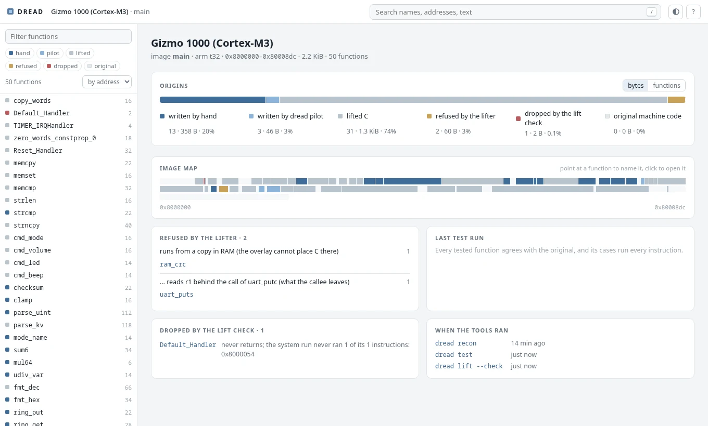

# DREAD

[](https://github.com/dwzg/dread/actions/workflows/test.yml)

**DREAD Reverse-Engineers And Decompiles**: *disassemble, rewrite, emulate and diff.*

A toolkit for rewriting embedded firmware in C, one function at a time, when the original compiler
is not available. Matching-decompilation tools assume you can recompile the original byte for
byte. DREAD instead proves the rewritten function behaves like the original:

1. **Disassemble.** Analysis tables (from Ghidra, or from an ELF when there are symbols) become a
   listing that reassembles to the original image, byte for byte. That rebuild is the baseline
   every change is measured against.
2. **Rewrite.** C functions are linked over the original image at their own addresses: in place
   when they fit, otherwise into space freed by other rewritten functions. Everything not rewritten
   stays the original machine code, so every intermediate state is a complete image. The C comes
   from three sources: written by hand, generated for families of identical functions, or lifted
   mechanically, instruction by instruction, as a first step.
3. **Emulate.** Every rewritten function runs in the original image and in the rebuilt one, in
   Unicorn, with the same inputs. Callees are stubbed and logged, and peripheral accesses are
   recorded in order. Inputs come from hand-written cases and from a generator that is guided by
   coverage and by the values each branch compares. The whole image can also run from reset with
   device models.
4. **Diff.** Return values, memory written, calls made and peripheral accesses must all agree, and
   so must every register a caller reads after the call: a compiler that saw the callee (GCC's
   `-fipa-ra`) may keep a value in a scratch register across it, and a rewrite has to leave that
   register alone. The cases must run every instruction of the original function. A mutation check
   confirms that the cases would notice a wrong function.

What this proves is agreement on the inputs tried, in an emulator. It is not a proof that an image
is safe to run on hardware.

## Status

<!-- status: written by bin/dread status from docs/todo.md, the gizmo builds' tables and the bench recipe; do not edit by hand -->

38 commands, 1,189 test functions run by CI on every push, 42 FreeRTOS builds in the benchmark on 4 architectures (`dread bench`). What each part does: [docs/features.md](docs/features.md); what comes next: [docs/todo.md](docs/todo.md).

| Architecture | Gizmo builds: lifted / functions | FreeRTOS builds | Progress |
|---|---|---|---|
| ARM: ARM state, Thumb, Thumb-2 (Cortex-M3) | a32 36 / 52 · m3 36 / 50 · m3cpp 43 / 61 | 25 | the architecture the tools began on |
| Cortex-M4F (FPv4-SP, DSP) | m4 44 / 58 | 2 | done |
| RISC-V (RV32IMC) | rv32 32 / 47 · rv32cpp 39 / 58 | 11 | done |
| MSP430 | msp430 79 / 130 | 1 | paused · `██████░░░░` 12 of 19 steps |
| x86, 32-bit (i386) | i386 – / 47 · i386clang – / 47 | 3 | `████████░░` 43 of 56 steps |
| MIPS32 | mips – / 47 | – | paused |
| AArch64 | – | – | planned |
| PowerPC 32 | – | – | planned |
| ARM big-endian (BE-8) | – | – | planned |
| AVR | – | – | planned |
| Z80 | – | – | planned |
| 8051 | – | – | planned |

Gizmo (`examples/gizmo`) is DREAD's own test firmware, built for each architecture: of each build's functions, those its lift check builds from lifted C (– where the build has no lift table yet).

| Feature (docs/todo.md) | Progress | Steps |
|---|---|---|
| [Readable C from lifted C](docs/todo.md#readable-c-from-lifted-c-the-user-2026-10-21-first-since-then-docsdecisionsmd) | `████████░░` | 72 of 92 |
| [Compiler diversity](docs/todo.md#compiler-diversity-the-user-2026-10-20-first-on-armcortex-m-and-risc-v) | `█████████░` | 30 of 35 |
| [Compiler lab](docs/todo.md#compiler-lab-dread-cclab-the-user-2026-10-19-before-anything-else) | `█████████░` | 9 of 10 |
| [Phase 4: cases, mutation, coverage](docs/todo.md#phase-4-cases-mutation-coverage-rest) | `████████░░` | 16 of 19 |
| [CI](docs/todo.md#ci) | `████████░░` | 3 of 4 |
| [Phase 6: lifter](docs/todo.md#phase-6-lifter) | `█████████░` | 15 of 16 |
| [The GUI for everything](docs/todo.md#the-gui-for-everything-the-user-2026-10-24) | `█████████░` | 9 of 10 |
| [Browser view](docs/todo.md#browser-view-dread-gui-asked-for-by-the-user-on-2026-10-18) | `████████░░` | 5 of 6 |
| [A realistic benchmark: FreeRTOS](docs/todo.md#a-realistic-benchmark-freertos-asked-for-by-the-user-2026-10-19-before-the-rest-of-msp430) | `████████░░` | 12 of 16 |
| [MSP430](docs/todo.md#msp430-of-special-interest-to-the-user-right-after-risc-v) | `██████░░░░` | 12 of 19 |
| [More architectures](docs/todo.md#more-architectures-each-a-gizmo-build-with-clang-the-arch-layer-every-tool-on-it) | `███████░░░` | 43 of 64 |
| [Floating point](docs/todo.md#floating-point) | `░░░░░░░░░░` | 0 of 1 |
| [More compilers](docs/todo.md#more-compilers) | `░░░░░░░░░░` | 0 of 6 |
| [Scale and robustness](docs/todo.md#scale-and-robustness) | `████░░░░░░` | 4 of 9 |
| [Documentation and packaging](docs/todo.md#documentation-and-packaging) | `██░░░░░░░░` | 1 of 4 |

Complete: [Performance, first pass](docs/todo.md#performance-first-pass), [Phase 5: system run](docs/todo.md#phase-5-system-run), [Performance, second pass](docs/todo.md#performance-second-pass-2026-10-18-asked-for-by-the-user), [Performance, third pass](docs/todo.md#performance-third-pass-2026-10-19-asked-for-by-the-user), [Phase 7: reading aids, plugin, documentation](docs/todo.md#phase-7-reading-aids-plugin-documentation), [After the ARM phases](docs/todo.md#after-the-arm-phases), [Cortex-M4](docs/todo.md#cortex-m4-armv7e-m-with-fpv4-sp-the-user-2026-10-19-first-among-the-new-architectures), [C++](docs/todo.md#c).

<!-- /status -->

## Quick start

```sh
python3 -m venv .venv && .venv/bin/pip install -e '.[test]'
bin/dread doctor                                   # what DREAD needs here, and what to install
.venv/bin/python -m pytest                         # DREAD's own tests, on gizmo
bin/dread test --target examples/gizmo/m3          # gizmo's rewritten functions against the original
bin/dread lift --target examples/gizmo/m3 --check  # lift every function, keep those whose cases agree
bin/dread readable --target examples/gizmo/m3 --plain print_status   # one function as readable C
bin/dread gui --target examples/gizmo/m3 --open    # all of it in the browser
```

For your own firmware, `bin/dread new ~/targets/fw fw.elf` makes a target from an ELF (or from a raw
image, with `--arch` and `--base`) and prints what to run next. Every command, setting up and the
language models: [docs/usage.md](docs/usage.md); the browser view: [docs/gui.md](docs/gui.md).



## Documentation

| Document | What it covers |
|---|---|
| [Usage](docs/usage.md) | the commands, setting up a target, language models |
| [The browser view](docs/gui.md) | `dread gui`: its pages, keys, jobs and the pilot |
| [Features](docs/features.md) | what each part of DREAD does |
| [Method](docs/method.md) | how a rewrite is shown to behave like the original: cases, lifting, readable C, the system run |
| [Targets](docs/target.md) | a target's `dread.toml` |
| [Formats](docs/formats.md) | the files DREAD reads and writes |
| [Porting](docs/porting.md) | adding an architecture |
| [Compiler lab](docs/cclab.md) | `dread cclab`: how a compiler compiles |
| [Decisions](docs/decisions.md) | what was decided, and why |
| [What to do next](docs/todo.md) | the plan, item by item |

## Repository layout

| Path | What it is |
|---|---|
| `dread/` | the Python package; `bin/dread` runs it from a checkout |
| `docs/` | the documentation (above) |
| `examples/gizmo/` | the test firmware: sources, builds and ten target directories (a32, m3, m4, m3cpp, rv32, rv32cpp, mips, msp430, i386, i386clang) |
| `tests/` | DREAD's own tests (`.venv/bin/python -m pytest`) |

## With Claude Code

The repository is also a plugin marketplace. The `dread` plugin has skills that drive the tools
(setting up a target, reading a firmware, rewriting a function, the system run), a writer and a
reviewer agent, and a template for a target's README:

```
/plugin install dread --marketplace dwzg/dread
```

The skills only point at the tools: whatever a program can decide, the tools decide.

## License

Apache License 2.0, see `LICENSE`.
