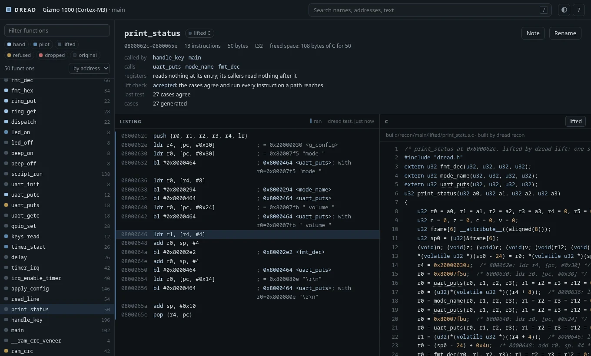
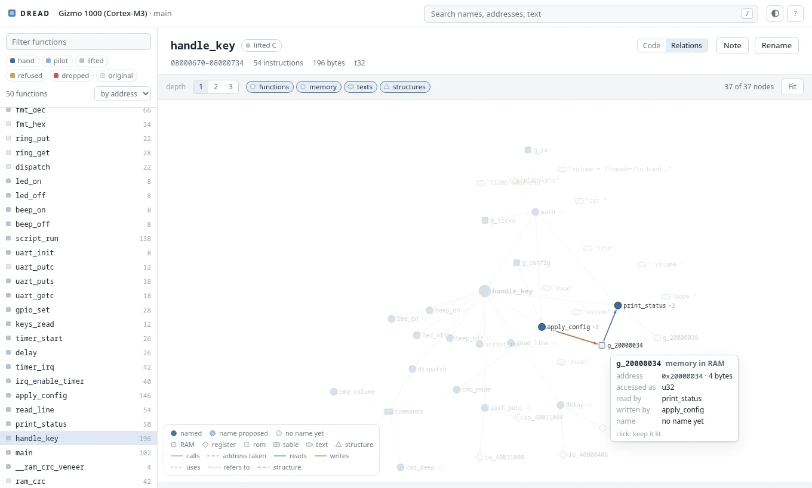
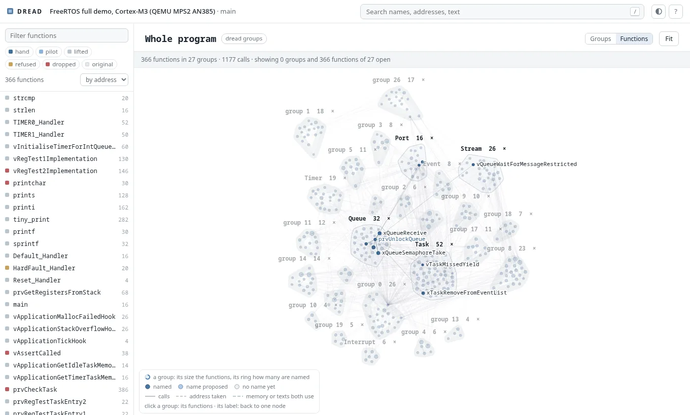

# DREAD

[](https://github.com/dwzg/dread/actions/workflows/test.yml)

**DREAD Reverse-Engineers And Decompiles**: *disassemble, rewrite, emulate and diff.*

A toolkit for rewriting embedded firmware in C, one function at a time, when the original compiler
is not available. Matching-decompilation tools assume you can recompile the original byte for
byte. DREAD instead proves the rewritten function behaves like the original:

1. **Disassemble.** Analysis tables (from Ghidra, or from an ELF when there are symbols) become a
   listing that reassembles to the original image, byte for byte. That rebuild is the baseline
   every change is measured against.
2. **Rewrite.** C functions are linked over the original image at their own addresses: in place
   when they fit, otherwise into space freed by other rewritten functions. Everything not rewritten
   stays the original machine code, so every intermediate state is a complete image. The C comes
   from three sources: written by hand, generated for families of identical functions, or lifted
   mechanically, instruction by instruction, as a first step.
3. **Emulate.** Every rewritten function runs in the original image and in the rebuilt one, in
   Unicorn, with the same inputs. Callees are stubbed and logged, and peripheral accesses are
   recorded in order. Inputs come from hand-written cases and from a generator that is guided by
   coverage and by the values each branch compares. The whole image can also run from reset with
   device models.
4. **Diff.** Return values, memory written, calls made and peripheral accesses must all agree, and
   so must every register a caller reads after the call: a compiler that saw the callee (GCC's
   `-fipa-ra`) may keep a value in a scratch register across it, and a rewrite has to leave that
   register alone. The cases must run every instruction of the original function. A mutation check
   confirms that the cases would notice a wrong function.

What this proves is agreement on the inputs tried, in an emulator. It is not a proof that an image
is safe to run on hardware.

## Status

Early: the tools are being moved over and generalised phase by phase, and the table below says
what works. The method and the first versions of the tools come from the reconstruction of
a 2004 digital camera's firmware (ARM7, ARM state). Here they are being made independent of that
firmware: everything a tool needs to know about a target comes from the target's `dread.toml`.
DREAD tests itself on **gizmo** (`examples/gizmo`), a small firmware written for the purpose and
built five times: with GCC for an ARM7-style core in ARM state, for a Cortex-M3 in Thumb-2 and for a
Cortex-M4 with hard float and the DSP extension (with a signal path of its own on floats); with clang
for an RV32IMC core; and with TI's MSP430 GCC for the 16-bit MSP430.

| Part | State |
|---|---|
| Target description, function tables, ARM and Thumb layer, ELF import | done |
| Listing generator and byte-identical rebuild, Ghidra pipeline | done |
| Emulator, differential test runner, overlay linker | done |
| Case generator (coverage- and compare-guided, pointer learning, a dictionary for parsers) | done |
| Mutation check with survivor search and argued survivors | done |
| Integration run: generated inputs with real callees, also through original callers | done |
| Register flow across calls: what callers read after a call, compared at the return | done |
| Recorded cases from Python models of callees (`dread record`) | done |
| System run from reset, original against rebuilt, on a shared clock; models for serial port, timer, pins, interrupt controllers (A profile, Cortex-M NVIC with SysTick) | done |
| Lifter for ARM and Thumb-2: instruction by instruction to C, built only when the generated cases agree and run every instruction of the original; its instruction semantics fuzzed against the emulator (`dread liftfuzz`) | done |
| Reading aids: flat listing, call sites with constant arguments, the same code in two images, names by call order, the functions in groups found from their code alone, the subsystems a reader would see (`dread groups`: shared memory, texts and devices, neighbours in memory); renaming everywhere at once (`dread rename`) | done |
| Browser view (`dread gui`): overview and map of the image, listings with coverage, the C, verdicts, search, rename and notes | done |
| Relations (`dread relations`, and in the browser): a function's callers, callees, memory, texts and structures as a graph, each piece marked by how sure its name is; the whole program as a graph of its groups (`dread groups --json`), a group opening into its functions; both laid out by a force simulation as they are drawn | first version |
| Claude Code plugin (skills, writer and reviewer agents, a target template) | done |
| Method documentation and a porting guide | done |
| Library functions by their bytes (`dread whatcc`): the C library, libgcc and libm of every toolchain image, the host's and archives of one's own matched against an image's functions, the linker's fields masked: which toolchain's libraries it links (ties said as such) and names for a firmware without symbols (calls checked, ambiguous names given as such); ARM (RISC-V's relaxed calls not yet) | done |
| Readable C from lifted C (`dread readable`): transformations in code on the lifters' C, each function's result built and accepted only as lifted C is (its cases agree and run every instruction, the whole image agrees), else it stays lifted. So far the parser, the gate, the clean-up (flags, dead code, compares as comparisons proved with z3), the structure (if/else and loops for the gotos), calls and parameters as regflow measured them, registers split into their values, names proposed by a language model as a map that code applies and checks (`dread pilot --task readable`, scored against debug information with `dread readable --score`), and the structures behind pointers found by code (`dread readable --shapes`; 91-99 % of the fields it finds are the source's on four FreeRTOS builds) and written into the C as `volatile struct` pointers (`p->f_2c`), and the part of a stack frame whose addresses go to callees as one local structure (`stack36.f_4`, `(u32)&stack36.f_4`); measured on the FreeRTOS bench against the sources (`dread bench measure --steps readable`: per build what the gate accepts and why not, gotos, nesting, raw accesses and members left, and each function's statements and nesting against its source function, found through DWARF and read by clang) | in progress |
| Compiler profiles for the lifter and the template families (gcc, older ARM compilers) | next |
| `dread pilot`: the reconstruction loop run by code, an LLM (local or cloud) only for the judgement: writing C, arguing survivors, proposing inputs and names (optionally shown what a function did in runs of its cases: `dread.behaviour`, or the subsystem its group was named from all of the group's evidence: `--subsystems`; scored against the source by a judge that reads it, whatever the names' style: `--score --grounded`), naming readable C's variables; every answer checked by the tools. Providers: OpenAI-compatible servers (llama-server, GitHub Models), Anthropic, or a command line that answers (GitHub Copilot CLI, Claude Code headless); `dread llm ask` tries one | first version |
| RISC-V (RV32IMC): gizmo-rv32 built with clang; every tool runs on it: listing with byte-identical rebuild, reading aids, the overlay, differential tests, integration, recorded cases, regflow, switches, Ghidra, the system run with interrupts, the lifter and its fuzzer | done |
| Cortex-M4 (FPv4-SP, DSP extension): gizmo-m4 built with GCC with hard float, run on Unicorn's own Cortex-M4 (the core a target names: an M3 has no FPU); every test runs on it; the lifter, the harness and the system run do not model the FPU and the DSP instructions yet (its float and DSP functions are refused) | under way |
| MSP430: gizmo-msp430 built with TI's MSP430 GCC; a decoder of its own (no capstone), an engine of its own (no Unicorn: a Python interpreter behind Unicorn's interface, checked against GDB's simulator), the listing with byte-identical rebuild, the reading aids, the overlay (into the image's free flash), differential tests with generated cases, the mutation check, integration, regflow, the lifter (stack arguments included) and its fuzzer, the system run (interrupts through the vector table, low-power modes) with recorded cases and the lift check's system check | under way |
| MIPS32 (little endian, release 2): gizmo-mips built with clang, the image in kseg1; the layer's own decoder (checked against llvm-mc), the listing with byte-identical rebuild, the function list | paused after step 1 of 6 (the user, 2026-10-20: compiler diversity first); step 2 on the branch `mips` |
| C++: gizmo-m3cpp and gizmo-rv32cpp, gizmo's Cortex-M3 and RV32 builds with a C++ part (virtual methods, a template used twice, a static constructor), g++ and clang++ with -fno-exceptions -fno-rtti; names shown demangled, template families, `.cpp` sources in the build, a method rewritten in C++ and one in C, vtables valid across a moved method, the constructor in the system run | done |
| Compiler lab (`dread cclab`): probe programs compiled across a compiler's option matrix and run in the emulator: where arguments and results go, the types, which runtime helper each operation calls and what it changes, the shape of the code, what a call keeps; on ARM, RISC-V and MSP430; adapters for GCC (ARM, RISC-V, MSP430), clang, Arm's LLVM toolchain, TI's armcl and IAR EWARM (from WSL), with a guard that keeps a proprietary toolchain's code from a language model; `docs/cclab.md` | first version |

## Layout

| Path | What it is |
|---|---|
| `dread/` | the Python package; `bin/dread` runs it from a checkout |
| `docs/` | the method (`method.md`), porting to another architecture (`porting.md`), the target description, the file formats |
| `examples/gizmo/` | the test firmware: sources, builds and eight target directories (a32, m3, m4, m3cpp, rv32, rv32cpp, mips, msp430) |
| `tests/` | DREAD's own tests (`.venv/bin/pytest`) |

## Using it

```sh
python3 -m venv .venv && .venv/bin/pip install -e '.[test]'
.venv/bin/pytest                         # DREAD's tests on gizmo
bin/dread info --target examples/gizmo/m3
bin/dread recon --target examples/gizmo/m3      # gizmo's rewritten functions over the original
bin/dread test --target examples/gizmo/m3       # each one against the original, in the emulator
bin/dread mutate --target examples/gizmo/m3 --kill checksum   # would the cases notice a wrong one?
bin/dread integration --target examples/gizmo/m3 --callers    # the same with real callees, and through callers
bin/dread sysrun --target examples/gizmo/m3                   # the whole firmware from reset, both images
bin/dread sysrecord --target examples/gizmo/m3 --scenario config read_line   # cases from what the run saw
bin/dread lift --target examples/gizmo/m3 --check  # lift every function, keep those whose cases agree
bin/dread readable --target examples/gizmo/m3 --check  # build the lifted functions from readable C where the cases agree
bin/dread liftfuzz --isa t32                        # the lifter on random instructions, against the emulator
bin/dread test --target examples/gizmo/rv32         # the same tools on the RISC-V build
bin/dread bench all freertos                        # a real project built many ways, measured (in ~/dread-bench)
bin/dread cclab run --adapter gcc-arm               # how a compiler compiles: probes run in the emulator
bin/dread cclab compare ti-arm gcc-arm              # where two compilers differ, and the options that close it
bin/dread whatcc --target ~/dread-bench/freertos/mps2-gcc7-Os   # whose C library it links, and names for its functions
bin/dread flat --target examples/gizmo/m3 print_status        # one function to read: names, literals, arguments
bin/dread callsites --target examples/gizmo/m3 --by 0 gpio_set # who calls it, with which constants
bin/dread relations --target examples/gizmo/m3 print_status   # what it calls, reads, writes and prints
bin/dread groups --target examples/gizmo/m3                   # its functions in groups: the subsystems a reader would see
bin/dread callpair --target OTHER --other examples/gizmo/a32 --seed FUN_08000738=main   # names by call order
bin/dread rename --target examples/gizmo/m3 beep_on=buzzer_on  # a new name everywhere, or nowhere
bin/dread pilot --target examples/gizmo/m3 --limit 4          # a language model writes C, the tools decide
bin/dread gui --target examples/gizmo/m3 --open               # all of it in the browser
```

### In the browser

`dread gui` serves a page on this machine (127.0.0.1:8350) that shows what the tools know and
decided: where each function stands (written by hand, by the pilot, lifted, refused, original), a
map of the image, the listing with the instructions the cases ran or missed, the C beside it,
verdicts and cases, search by name, address and text. It changes nothing but names (through `dread
rename`) and notes (annotations.txt); everything else is the tools' work. Keys: `/` search, `j` `k`
lines, `Enter` follow, `n` rename, `;` note, `r` relations, `p` the whole program, `?` all of them.

A function's relations are the pieces of the puzzle around it, as a graph:
- its callers above and callees below, to a depth of 1 to 3;
- the memory its readable C reads and writes;
- the texts and tables its constants point to;
- the structures its variables point to.

Each piece is coloured by how sure its name is: named, proposed by the pilot, or none yet. A click
walks to another function; pointing at a piece lights what it joins.

The whole program (`p`) is a graph of the groups `dread groups` finds from the code: each group a
node, sized by its functions and named by the pilot where it named it, joined by the calls, taken
addresses and shared memory between them. A click opens a group into its functions; a program of a
few hundred functions shows all of them at once. Both graphs lay themselves out as they are drawn:
nodes overshoot a little and settle, a change of the graph morphs from the picture before, and a
dragged node pulls its neighbours along. With reduced motion asked for, the settled picture shows at
once. Thousands of nodes stay in motion: the whole program is drawn on a canvas, its repulsion
approximated by Barnes-Hut.






### With Claude Code

The repository is also a plugin marketplace. The `dread` plugin has skills that drive the tools
(setting up a target, reading a firmware, rewriting a function, the system run), a writer and a
reviewer agent, and a template for a target's README:

```
/plugin install dread --marketplace dwzg/dread
```

The skills only point at the tools: whatever a program can decide, the tools decide.

A target is any directory with a `dread.toml` (`docs/target.md`). The tools find it from the
working directory, from `--target`, or from `$DREAD_TARGET`.

## License

Apache License 2.0, see `LICENSE`.
